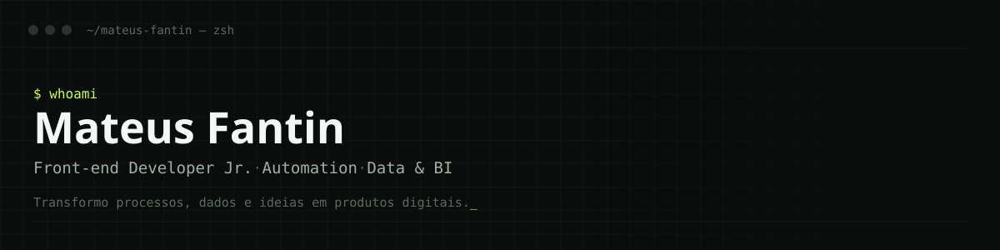

<br/>

[LinkedIn](https://linkedin.com/in/mateus-fantin) · [Portfólio](https://mateusfantin.netlify.app) · [Contato](mailto:matfp3@hotmail.com)

## Sobre

Comecei na CVC Corp, negociando produtos aéreos e resolvendo problemas de cliente sob prazo apertado — foi ali que aprendi a lidar com sistemas, processos e pressão real de negócio, bem antes de escrever a primeira linha de código.

Formado em Análise e Desenvolvimento de Sistemas, hoje construo interfaces, automatizo processos e trabalho com dados. Estou no início da carreira em tecnologia, mas chego nela com experiência profissional, visão de negócio e uma base de projetos reais — não só exercício de curso.

## O que estou construindo

**Fog Roulette** — sorteador visual com conta de usuário, pensado pra criadores de conteúdo sortearem prêmios sem depender de planilha ou app genérico.
`Next.js` `React` `Supabase`
[demo](https://fogroulette.netlify.app) · [código](https://github.com/mateozord/fog-roulette)

**Porão Gráfico** — plataforma de encomenda de serviços de design gráfico, do catálogo ao checkout, tirando a negociação inteira do WhatsApp manual.
`React` `Vite` `Tailwind CSS`
[demo](https://porao-grafico.netlify.app) · [código](https://github.com/mateozord/porao-grafico)

**Vistamed** — redesign conceitual pra uma clínica oftalmológica: reorganiza os procedimentos por categoria e leva o agendamento direto pro WhatsApp.
`HTML` `CSS` `JavaScript`
[demo](https://vistamednovo.netlify.app) · [código](https://github.com/mateozord/vistamed)

## Stack

```
front-end    React · Next.js · JavaScript · HTML · CSS · Tailwind CSS
dados        SQL · Power BI · Excel
ferramentas  Supabase · Git
workflow     IA aplicada ao desenvolvimento — acelero implementação,
             estudo soluções e transformo ideia em projeto funcional
```

## Trajetória

```
turismo & operações  →  ADS  →  desenvolvimento  →  automação & dados
```

<br/>

<sub>Aberto a oportunidades como Desenvolvedor(a) Júnior — front-end, automação de processos ou dados.</sub>
